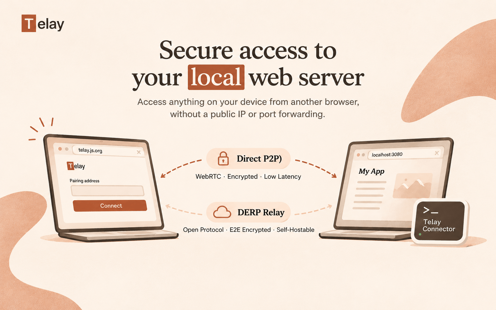

# Telay

[](https://github.com/telay-dev/telay-dev.github.io/actions/workflows/release-site.yml)
[](https://www.npmjs.com/package/telay-cli)
[](LICENSE)



Connect to a local web service from another device through a browser. The Go connector supports HTTP, WebSocket, and server-sent events. It uses WebRTC when possible and DERP relay otherwise.

## Quick start

Run the Connector with Node.js 18 or newer:

```sh
npx telay-cli --web https://telay.js.org --upstream http://127.0.0.1:3080/
```

Or install it globally with `npm install -g telay-cli` and run `telay --web https://telay.js.org --upstream http://127.0.0.1:3080/`. Prebuilt executables are also available from [GitHub Releases](https://github.com/telay-dev/telay-dev.github.io/releases/latest).

The connector saves its pairing identity locally and reuses the same pairing address after restart. Active connections still need to reconnect. Use `--state /path/to/identity.json` to select an identity file, or `--ephemeral` for a temporary pairing address. See [connector usage](connector/README.md) for storage and recovery details.

Open [telay.js.org](https://telay.js.org) and enter the pairing address printed by the connector. Keep the address private; it grants access to the configured service.

## Development

Requirements: Node.js 22+, pnpm 10+, and Go 1.27.2+.

```sh
pnpm install --frozen-lockfile
pnpm dev
pnpm build
pnpm test
cd connector && go test -race ./...
pnpm release
```

`pnpm release` builds executables for macOS, Linux, and Windows. `pnpm package:npm` assembles the npm packages from those executables. The npm package version is maintained in `npm/telay/package.json`; platform package versions must match. The GitHub Actions workflow publishes downloads on GitHub Releases and deploys the site to [telay.js.org](https://telay.js.org) on pushes to `main`.

For npm releases, update the version and all platform dependency versions in `npm/telay/package.json`, then push a matching `npm-v<version>` tag. The npm publishing workflow builds the binaries and publishes the platform packages before `telay-cli`. Configure an npm trusted publisher for each package with the `telay-dev/telay-dev.github.io` repository and `npm-publish.yml` workflow before using the automated release.

Telay is licensed under [MIT](LICENSE). Third-party notices are in [THIRD_PARTY_NOTICES.txt](THIRD_PARTY_NOTICES.txt).
